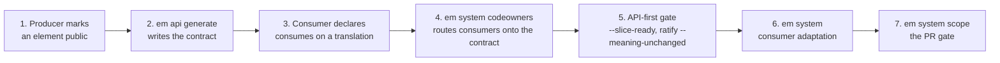
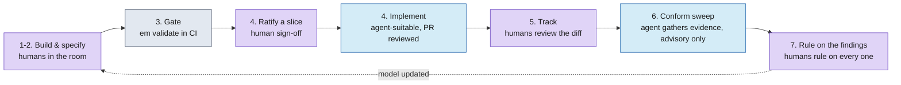

# The process: who does what

Event Modeling is a Software Development Life Cycle activity whose product is **shared
clarity** — stakeholders, product owners, and engineers agreeing, in one artifact, on how a
business process works and what must always be true about it. `em` mechanizes the artifact
(rendering, validation, diffing, drift detection); it never replaces the people. This document
is the map of which parts of the workflow require humans in the room, which parts an agent can
carry with human review, and where the boundary between them sits.

The other docs cover the mechanics: [workflow.md](workflow.md) is the lifecycle stage by
stage, [ai-workflow.md](ai-workflow.md) is the Claude Code skill. This one is organized by
**responsibility**.

## The one rule everything else follows from

> **Agents propose. Humans ratify.**

The model's entire authority rests on one property: everything in it was decided by a person,
on purpose. A stakeholder can trust the diagram, a product owner can trust a slice's
invariants, and an engineer can build against them *because* nothing entered the model by
autocomplete. Agents can draft, extract, render, diff, flag, and propose as hard as they like
— but the moment an agent writes an unratified decision into the model, the model stops being
a record of decisions and becomes just another generated artifact.

That's why the human checkpoints below are not process ceremony to optimize away. They are the
product.

## What "ratified" means

Used throughout these docs and the skill, **ratified** means: *a human decided this,
deliberately, and the decision is recorded in the model or its slice docs.* It shows up at
three specific points:

1. **Ratifying a slice** — the sign-off, after review, that flips a slice doc's `status` from
   `reviewed` to `ready-to-implement`: contracts and invariants are agreed, and every open question is
   resolved or explicitly deferred ([`em slice defer`](cli.md#em-slice-defer-file-slice-key-question) —
   positional for a question already on the doc, `--from-issue` for one the room raised as an
   `issue "..."` note). The sign-off names exactly what it signed: `em slice ratify` records the
   commit (`ratifiedRef`), the body hash (`ratifiedHash`) and a hash per section (`ratifiedSections`),
   and refuses a doc with uncommitted changes — so deferrals, which edit the body, come before it.
   This is the second of the two per-slice human gates (the first is the review session; the whole
   sequence is [The slice lifecycle gates](#the-slice-lifecycle-gates) below), the handoff gate
   between deciding and building. It is mechanically checkable: `em validate <model>.em --slice-ready
   <key>` verifies the doc, status and open-question state in one command
   ([cli.md](cli.md#--slice-ready-key-mil-87)).
   `em slice ratify <model>.em <key> --by <name>` (MIL-165) makes the sign-off one mechanical edit
   that records *who* and *when* in `ratifiedBy:`/`ratifiedOn:` beside the `status` flip
   ([cli.md](cli.md#em-slice-ratify-file-slice-key---by-name)). `ratifiedBy:` is a *record* of who
   signed, not a permission: `--by` is free text and unauthenticated, and the authenticated approval is
   your git host's review of the pull request that carries the sign-off. Who may approve is the host's
   decision — a [CODEOWNERS](ci.md#codeowners-routing-ratification-review) rule on `slices/**` plus
   branch protection means the edit can't merge without review by a designated ratifier. (An optional
   [roster](policy.md#the-roster-is-optional) exists for teams with no host enforcement.)
   **Changing a signed slice** takes one of three routes, by what changed
   ([the four cases](#revision-re-enters-the-loop-at-the-top) below): `em slice amend` re-signs a
   prose-only change in place; `em slice revise` reopens the doc as a `draft` for a behaviour change,
   at the **same** `version:` while that version has not shipped (GH #486) and at v(N+1) once it
   has — the prior sign-off cleared, the shipped version kept in the shipped record
   ([slice-doc-schema.md](slice-doc-schema.md#status-under-re-ratification)). A reviewer reading
   `status: draft` on a shipped slice's merge PR should look at `shippedVersion:`/`implementedIn:` —
   that is the record of implementation; `status:` is the next version's state, and `em status` shows
   `implemented (v<n>) · draft v<n+1> open`. `em slice mark-implemented` opens the next version
   itself at merge when a question was deferred to it.
   **API first (MIL-238):** ratifying a *public-touching* slice — one that owns a `public`
   command, event or view — also asserts that the model's generated contract
   (`contracts/<model key>.tsp`, written by `em api generate`) is current, and says whether this
   version changes what that contract means to a consumer: `--meaning-unchanged`, or
   `--contract-change "<why>"`, recorded as `meaningConfirmed:`/`contractChange:` frontmatter.
   `em slice ratify` refuses such a slice without one (and takes it again on every revised
   version), and `--slice-ready` is not ready until the committed contract matches the model.
2. **Ratifying model changes** — every edit to a committed `.em` or slice doc is a ratified
   decision, made in (or reviewed out of) a facilitated session. The PR review of a model
   change is part of this: the diff *is* the decision record.
3. **Ruling on conformance findings** — a *ruling*, not a ratification (the word is reserved
   for the design-exit gate in point 1), but the same human-decides shape: when the conform
   phase reports drift between model and code, a human rules on every finding (fix the model,
   open a red note, fix the prose — [workflow.md](workflow.md#7-rule-on-the-findings)). A ruling is a
   human gate, the same shape as ratifying a slice: an agent gathers evidence and proposes, a person decides, and the decision
   is recorded with a name and a date. The report proposes; you decide.
   **The findings themselves are structured data** (MIL-214): the conform skill writes
   `conformance/<date>-findings.json` alongside its `<date>-report.md` (the gates read every same-revision
   `conformance/<date>-<name>-findings.json`, e.g. one file per slice; a ruling is written to the file the report names; the lookup uses the report's own `Target repo: … @ <rev>` revision, the caller's only when the report has none), one entry per `### n.`
   finding, ids matching (shape: [slice-doc-schema.md](slice-doc-schema.md);
   `em conform-findings check <path>` verifies a headless run wrote it correctly).
   `em conform-supersede <model> <report-path> --as-of <rev> --findings <spec> --locus <model|doc|code|none> --by <name>`
   (MIL-164/MIL-214,
   [cli.md](cli.md#em-conform-supersede-file-report-path)) is what records BOTH the ruling
   itself — `locus`/`resolvedBy`/`resolvedOn` on the named findings in that JSON — and the
   ruled-on report's "superseded as of `<rev>`" banner, so the record of what was decided
   stays legible without misleading a later reader into treating a historical report's
   file:line citations as current. `locus: code` on an unresolved finding is the first-class
   carrier for "spec is right, code is wrong" — no doc delta needed for that case any more.
   Once every in-scope finding touching a slice is ruled, that slice's certification is
   recorded — by `em conform-supersede` itself in the same run (GH #497, one `certified:` line
   per slice, at its `--as-of` revision), or by `em slice conform <model> <key> --at <rev>`
   (MIL-214, [cli.md](cli.md#em-slice-conform-file-slice-key---at-rev)) for a slice with no
   findings or a re-run — that THIS VERSION of that slice was certified, a fact `em state
   set-conformance` (below) checks before advancing the model-wide marker.
   `em state set-conformance` refuses while any `implemented` slice still has an unruled finding
   in scope (`--partial` escapes with a loud notice); nothing writes the marker for you.

## The slice lifecycle gates

A slice doc travels through four statuses, and **two of the three transitions between them are
human gates**. Each has its own command, its own recorded name and date, and — deliberately — its
own moment:

```
draft ──(review session)──▶ reviewed ──(ratification gate)──▶ ready-to-implement ──(merge)──▶ implemented
```

1. **`draft`** — the doc exists and is being written. `em slice new` scaffolds it here; the
   `slice` phase of the skill fills it in. No gate: drafting is work, not a decision.
2. **The review session → `reviewed`.** A facilitated walkthrough with the people who know the
   domain. A slice whose open questions are all resolved in the room ends the walkthrough with
   `em slice review <model>.em <key> --by <name>` ([cli.md](cli.md#em-slice-review-file-slice-key---by-name)),
   which flips `status` to `reviewed` and records `reviewedBy:`/`reviewedOn:`. Anything still
   open stays `draft`: since 1.18.1 `em slice review` refuses a doc with an unchecked
   `## Open Questions` item. `--allow-open` records a deliberately partial walk and prints a notice.
   `--again` re-records the review after a body edit. **The facilitator never ratifies in a review session** — that is the next
   gate, and it is not theirs to run.
3. **The ratification gate → `ready-to-implement`.** Human, per-slice, and *typically
   multi-person*: the ratifier plus whoever will own the build. `em slice ratify <model>.em <key>
   --by <name>` ([cli.md](cli.md#em-slice-ratify-file-slice-key---by-name)) makes the sign-off one
   mechanical edit recording `ratifiedBy:`/`ratifiedOn:`, and by default it **refuses a doc that never passed
   through `reviewed`** unless `--skip-review` is passed (a loud notice on stderr, and a
   `reviewSkipped:` line on the doc so the bypass stays visible). A team that reviews slice docs in
   the pull request can declare `review: pull-request` in [`em-policy.yaml`](policy.md): ratify
   then accepts a `draft`, applies the review gate's Open Questions check, and records the review
   (`reviewedBy:`/`reviewedOn:`) with the sign-off, with no `reviewSkipped:` marker. The "multi-person" part is routed by the platform,
   not by `em`: the git host decides who may approve. Put a [CODEOWNERS](ci.md#codeowners-routing-ratification-review) rule on
   `slices/**` naming your ratifiers, so the edit itself can't merge without their review.
   Confirm readiness mechanically with `em validate <model>.em --slice-ready <key>`.
   **Ratification is the handoff gate, so time it that way.** Hold slices at `reviewed` while a
   storyline is still being shaped — a `reviewed` doc is free to edit (`em slice review --again`
   re-records the review), a ratified one is not — and ratify the storyline's slices together, in
   one batch run (`em slice ratify <model>.em <key>... --by <name>` or `--storyline <name>`), once
   it is shaped end to end or the slices are about to be dispatched. A public-touching slice is
   ratified singly, with its meaning flag. `em engagement plan` lists an engagement's
   reviewed-but-not-ratified slices with the command to run.
4. **The merge → `implemented`.** Not a gate — bookkeeping. The implementing agent or engineer
   runs `em slice mark-implemented <model>.em <key> <pr-url>` at merge; the human checkpoint here
   was the PR review, which already happened. It writes the **shipped record** (`shippedVersion:`,
   `shippedRef:`, `shippedOn:` beside `implementedIn:`, MIL-284) — the fact every reader that asks
   "has this shipped?" decides on from 1.15.0 — and, when a question was deferred to the next
   version, opens that version as a `draft` on the spot (MIL-283), so the diagram shows a slice
   with known work rather than an `implemented` one hiding it.

A **continuation slice** (MIL-208 — a later `view X again` instance with no doc of its own)
skips all four statuses and both gates above: it inherits the originating slice's status
wholesale, since it isn't a spec unit to review, ratify, or mark implemented separately. See
[slice-doc-schema.md](slice-doc-schema.md#continuations).

### Revision re-enters the loop at the top

A change to a signed slice takes one of four routes, by what changed and whether the version has
shipped. The cost follows the size of the change; no route removes a human sign-off, and an agent
runs none of them on its own authority.

| What changed | Command | Version | Gates |
|---|---|---|---|
| Prose only: intent, trigger and actor, dependencies, consumed-by (the [default list](policy.md), settable per project) | `em slice amend <model>.em <key> --by <name>` | unchanged | one sign-off by the amender; review record kept, slice stays `--slice-ready` |
| Behaviour, version **not yet shipped** (a gap found mid-build) | `em slice revise <model>.em <key> --withdraw` | unchanged: a number moves only once that version has shipped (GH #486) | review, then ratify, as for any draft |
| Behaviour, version **shipped** | `em slice revise <model>.em <key>` | v(N+1), the shipped version kept in the shipped record | review, then ratify, then a build of the delta |
| The model only (a contract moved, or em writes the generated regions differently) | `em slice sync <model>.em` | unchanged | none: the signature covers authored text |

**Amend.** `em slice amend` ([cli.md](cli.md#em-slice-amend-file-slice-key---by-name)) re-signs a
prose-only change in place: it re-stamps `ratifiedHash:`/`ratifiedSections:` and records
`amendedBy:`/`amendedOn:`. It refuses, writing nothing, when any changed section is behaviour
(an unknown heading counts as behaviour); that change goes through `revise`. `--by` names a human,
exactly as for ratify. For a slice that has not shipped, the amendment travels in the implementation
PR that found the gap, so the reviewer of the code reads and approves the new wording in the same
review; for a shipped slice it is a small doc-only PR.

**Revise.** `em slice revise` ([cli.md](cli.md#em-slice-revise-file-slice-key)) reopens the doc as
a **`draft`**: the old sign-off and review record are cleared (neither describes the new text), and
the shipped version, if any, stays in the shipped record so every reader still sees it in
production. The doc then takes the same two gates v1 did: `em slice review --by`, then
`em slice ratify --by`, which signs a fresh `ratifiedRef`. A revision is a new spec, so "the room
understood this slice" has to be true of the revised text too. For a shipped slice, record the hop
in the `## Delta` section; a never-shipped version owes no delta, since there is nothing shipped to
be a delta of. `--keep-version` is a no-op: not bumping is already the default.

**A question found mid-build on a ratified doc is deferred into the doc, outside the hash** (GH
#253). A ratified doc's body is what was signed (`ratifiedHash`), so adding a `- [ ]` under
`## Open Questions` by hand breaks `--slice-ready` and makes `ratify` refuse the changed body, and
`revise --withdraw` would withdraw the only implementable version. But a *deferral* describes a
later version, not the one that was signed, so the hash leaves the `## Open Questions` heading and
its `deferred to v<n>` items out: `em slice defer <model>.em <key> "<question>" --until v<n>
--decision "…"` on a ratified (or shipped) doc appends the already-deferred `- [x]` item — the hash
stays valid, the build goes on, and anyone reading the doc (an implementer, a reviewer, the
readiness gate) sees what has already been raised against it. `em status` and `em export` show how
much work waits on later versions. When v<n> opens, the item is reopened as `- [ ]` in the new
draft: `mark-implemented` does it at merge, and `revise` on a shipped doc does it by hand. A
`revise --withdraw` on a never-shipped doc keeps the version number, so a question deferred to
v(N+1) stays deferred through it and reopens when v(N) ships. On a `draft`/`reviewed` doc defer
rewrites the existing `- [ ]`. `em slice revise` on a ratified, never-shipped doc refuses unless
you pass `--withdraw`: that is for changing the spec itself, not for recording a question. (1.16.0
queued such questions in `.event-modeling.md` instead, GH #236; anything still queued there is
injected when the next draft opens, and `em upgrade` moves it into the doc.)

**A model change reaches a ratified doc through `em slice sync`, not a re-ratification** (GH #347,
1.19.0). The signature covers what the ratifier wrote: `ratifiedHash` leaves out the text between
each generated region's markers, which only restates the model. So when the model changes (or a
new em version writes the regions differently), run `em slice sync <model>.em`: it rewrites the
regions of ratified and shipped docs too, keeps `ratifiedHash` and `ratifiedRef`, and says so.
Model-change discipline lives in the model's own pin: the slice-ready gate requires the slice's
model version (`model-versions/v<N>.json`, `modelHash`) to be current, so a contract change is still
a decision someone records. Changing the *authored* text is `amend` (prose) or `revise` (behaviour).
A scenario stub sync writes into a signed doc's region is reported by `em validate`
(`slice-doc/generated-region-placeholder`) until the scenario is written in `## Scenarios` in the
next version — the sync that follows retires the covered stub (GH #368) — or the model gap behind a
`{{ }}` cell is filled.

Why two gates and not one: "the room understood this slice" and "we commit to building this
slice" are different decisions, made by different people, often days apart. Collapsing them means
whoever facilitated the review also authorized the build — which is exactly the failure the
one rule at the top of this document exists to prevent. A team that already reviews slice
docs in the pull request may declare that review to be the review session (`review: pull-request`
in [`em-policy.yaml`](policy.md)); the two sign-offs are still recorded, and the ratifier is still
a named human.

## Inline ratification: approval as the ratification session

GH #399, 1.20.0. Everything above describes ratification as its own PR: a doc-only change lands
on `main` before the slice's implementation branch is even cut. That separation buys three things
— a reviewer who reads the spec undiluted by implementation diff, a frozen contract before code
exists, and an immutable ratified-on-`main` audit anchor — at the cost of two serialized human
merges per slice instead of one. **Inline ratification** is the documented alternative: draft and
implement the same slice on one branch, spec commits first, and let the human's review of that
one PR *be* the ratification session.

Nothing about the CLI changes. `em slice ratify` has never required a separate branch — its only
demand is that the doc have no uncommitted changes (ratification records the exact commit, or
hash, of the body it signs). Inline mode is a documented way of using the existing commands, not a
new mode of any of them:

1. Draft the slice doc and the implementation on one branch, doc commits first (same discipline as
   always: don't write code before the thing it implements is specified).
2. Open the PR. **The human's review of that PR is the ratification session.** They read the doc,
   decide it's right, and the act of approving records it: run `em slice ratify <model>.em
   <key> --by <name>` as part of approving (on a branch headed for a squash or rebase merge, declare
   `merge: squash` or `merge: rebase` once in [`em-policy.yaml`](policy.md) and ratify records the
   hash only; `--no-ref` does the same per run — see
   [cli.md](cli.md#em-slice-ratify-file-slice-key---by-name). `ratifiedHash:` alone still
   verifies the exact body that was signed), or have a bot/check stamp it the
   moment the approval lands. Either way, the ratifying edit is itself part of the PR, under the
   same review.
3. Merge. `em slice mark-implemented` runs at merge exactly as it always has (§"The slice
   lifecycle gates" above, point 4).
4. **Any doc edit after the sign-off trips the existing hash check** — inline mode adds no new
   guardrail here because it needs none: `ratifiedHash` (MIL-284) already covers exactly this. If
   conform or review surfaces a gap mid-build, the loop is the same inline as across two PRs: a
   prose gap is re-signed in place by the human with `em slice amend --by <name>`, in this PR; a
   behaviour gap goes through `em slice revise --withdraw` and a second review and ratify. Running [`em slice conform <model>.em <key> --at <rev> --preview`](cli.md#em-slice-conform---preview-gh-400)
   before the PR merges — the pre-ship advisory conform, waiving the shipped-status precondition —
   is the inline loop's natural "did I drift from the doc I just signed" check: ephemeral by
   default, never writes `conformedVersion`/`conformedAt`/`conformedOn`, and never blocks the
   merge by itself.

**Not a loosened rule.** Agents still never self-ratify — `em slice ratify`/`em slice
mark-implemented` behave identically whether they're invoked from an inline branch or a doc-only
one; there is no flag, mode, or heuristic anywhere in `em` that lets an agent flip a doc's status
without a named human behind `--by`. The gate *moves* — it sits in the one PR review that's
already happening, instead of a dedicated prior one — it does not disappear and nothing about it
becomes mechanical.

### Risk tiers: when inline is allowed

Not every slice is a good candidate for folding the two merges into one. The risk being traded
away is reviewer attention isolation and audit anchoring — cheap to give up for a slice nobody
outside the team depends on, expensive for one that is itself a promise to other teams or to
parallel builders:

| Tier | Slices | Why |
|---|---|---|
| **Inline allowed** | Internal slices — the common case | No outside party is reading the diff for the spec alone; the one-PR review is sufficient |
| **Separate doc PR required** | Public-contract-touching slices — a slice owning a `public` command, event or view, the same boundary `em slice ratify` already computes (`isPublicTouchingSlice`, [`src/catalog/apiFirst.ts`](https://github.com/milehimikey/em/blob/main/src/catalog/apiFirst.ts)) and gates on via `--meaning-unchanged`/`--contract-change` (see "Ratifying a slice" above) | The contract is a promise to consumers who never see the implementation diff; freezing it before code exists is the whole point of the API-first gate, and inline mode would let the two change together uninspected |
| **Separate always** | Engagements (`em engagement`) | Structurally necessary, not a risk call: engagements dispatch N implementers against *already-frozen* contracts in parallel, so ratification has to precede every branch, not share one with it. (A slate doc-PR already amortizes the two-merge cost across every slice it covers, so this tier gives up little.) |

When the rows overlap, the stricter row wins: a slice that is both internal and
engagement-dispatched follows the engagement row — separate ratification always; engagement
membership overrides the internal-inline allowance.

`em` checks the table at PR time, not at ratification: `em inline-check <model>.em --base <rev>`
([cli.md](cli.md#em-inline-check-file---base-rev)) reports a slice whose doc was ratified in the same change set as implementation code,
judged by `ratification.inline` in `em-policy.yaml` ([policy.md](policy.md)) — public-touching slices by default, any slice
under `never` — as a warning unless `inline-violation: error`. Nothing refuses inline mode up front,
and the engagement row is not checked. The API-first gate already does the part that
matters: `em slice ratify` on a public-touching slice refuses without
`--meaning-unchanged`/`--contract-change`, inline or not, so the contract decision is still
recorded either way. The table is a team's own judgment call about *when to choose* the inline
shape, the same kind of judgment `docs/process.md` asks for everywhere else.

### The ordering advisory: `em refs --check-order`

Collapsing the two merges into one drops a property the separate-PR flow got for free: the spec
was necessarily frozen before the code existed, because the code's PR couldn't have started
without it on `main` already. Inline mode's real risk is **retrofit** — an agent builds first,
then writes the doc to describe what it already built, undetectably, because nothing marks when
in the branch's history the doc was actually decided.

`em refs --check-order` (GH #399, see [cli.md](cli.md#--check-order-gh-399-the-inline-ratification-ordering-advisory))
is a mechanical smoke-check for exactly that: for every slice doc carrying a `ratifiedRef:`, it
walks the branch's commits up to the ratification point looking for a commit that already touched
code before the doc was signed. (The other PR-time check, `em inline-check`, is described under the
risk tiers above: it asks *whether* a slice was ratified inline against policy, this one asks *in what
order*.) **It is advisory, never a validate gate, and it never affects the
exit code** — commit history is rewritable (a rebase can make any ordering look clean after the
fact), so this can only ever be a signal for the human already reviewing the PR, the same person
who is about to run `ratify` themselves. No em command gates on it, and none ever will under this
design: the human's judgment in the one PR review inline mode keeps is still the actual gate.

## Model versions

Every slice carries its own `version:`, but nothing above names *the model as a whole* — until
now (MIL-218). Two facts, kept deliberately separate, because they answer different questions:

- **Design version** — what was *decided*. An explicit, human-bumped integer, same identity
  discipline as ratification: `em model version bump <model>.em --by <name>`
  ([cli.md](cli.md#em-model-version-bump-file---by-name)). Bump it when the structure changes
  (a slice added or removed, a seam changed) or when a batch of slice deltas is ratified
  together — the same judgment call that decides "is this worth a changelog entry."
- **Certified version** — what was *proven*. Set by a full (non-`--partial`) `em state
  set-conformance` ([cli.md](cli.md#em-state-set-conformance-revision-dir)): "design version N was certified
  at revision R on date D." A `--partial` marker never certifies. Certification names what conform
  actually walked, never a guess: a full run that finds no design version, or a stale one, bumps it
  first (`--by <name>`, same code as `em model version bump`) and certifies the new version.

Both facts live in a sidecar manifest per design version, `model-versions/v<N>.json` (history,
not progress — see [model-versions.md](model-versions.md) for the shape), pointed to from two
new bullets in `.event-modeling.md`: `Model version:` and `Certified:`.

**A conform run bumps for you; the rest only warn.** If the slice-version vector or the `.em` file's
own content has moved since the last bump, `em status` and `em validate` (`model-version-stale`) say
so, and the next full `em state set-conformance --by <name>` bumps and certifies in one step (`em
slice ratify`/`revise` no longer print a version warning, since 1.23.0). `em model version bump` stays
available for a deliberate checkpoint the team calls earlier. The "humans ratify, tools verify" rule
holds: `--by` names who owns the bump, and nothing bumps without it.

## Seams between models: who does what

A project with several models (one per team or bounded context, each in its own directory, see
[cli.md, Multi-model projects](cli.md#multi-model-projects)) has seams: one model's translation
reads another model's `public` event or view. A seam is a promise between two teams, and the
same rule holds across it: agents propose, humans ratify. Here the people who ratify are the
teams on *both* sides. Since 1.14 the model is the single authority for that promise. The
producer's model generates the contract, and the consumer's model declares what it reads. Review
is routed and enforced along the seam, and no model's version number has to move.



1. **The producer marks an element `public`.** A `command` (the write API), `event` or `view`
   that another team or client depends on gets `public`. Its fields must then use the strict
   public type table (or `X[]`, or a declared `type`), or `em validate` errors with
   `public-field-type-unresolved` ([dsl.md](dsl.md#strict-public-types)). Two public elements of
   one kind cannot share a name (`public-name-not-unique`).
2. **`em api generate` writes the contract.** `em api generate <model>.em` turns the public
   surface into `<model dir>/contracts/<model key>.tsp`, committed with the model change and
   never edited by hand ([cli.md](cli.md#em-api-generate)). The header names its source and
   carries no source hash, so an internal edit never changes the file. `em api check <model>.em
   --base <rev>` fails when the committed file is stale and annotates each public-surface change
   `additive` or `breaking` for the reviewer.
3. **The consumer declares `consumes`.** The consuming model writes the dependency on its own
   translation: `translation Order Intake consumes checkout:event.order-submitted`
   ([dsl.md](dsl.md#consuming-another-models-public-surface)). `em validate` checks only the
   grammar. `em system` resolves the ref across models, from a `system.yaml` (schema 2.0: the list
   of models) or by discovering every tracked `.em` in the repository, and reports unknown models,
   unknown or non-public elements, public elements nobody consumes, and translations bound to
   nothing.
4. **`em system codeowners` routes review.** Each model header names its owning team
   (`model "Checkout" owner "@example/storefront"`). `em system codeowners` writes a managed
   CODEOWNERS block that puts that team on the model directory and *every consuming team* on
   the producer's contract file. With branch protection set to require code-owner review, a
   change to the public surface cannot merge without the teams that depend on it
   ([ci.md](ci.md#seams-consuming-teams-on-the-producers-contract)).
5. **The API-first gate.** A *public-touching* slice owns a `public` command, event or view.
   `em validate --slice-ready <key>` reports such a slice not ready until the committed contract
   matches the model (`slice-ready-contract-stale`; the message names the regenerate command).
   Ratifying or re-ratifying it also answers the meaning question: `--meaning-unchanged`, or
   `--contract-change "<why>"` when a consumer must read the change differently. `em slice
   ratify` refuses without one of the two, and record it as `meaningConfirmed:` or
   `contractChange:` frontmatter. A slice that owns a `public` command also needs that command's
   invariants declared in the model before it is ready
   (`invariants/public-command-without-invariants` is a warning scoped to the slice, and
   it is on the short list of warnings that gate `--slice-ready`; other warnings do not).
6. **`em system` checks consumer adaptation.** Every `consumes` binding's translation fields are
   compared with the producer's public element at HEAD. A field the consumer declares that the
   producer removed, renamed or retyped is the error `consumer-not-adapted`, naming both sides
   and the producer commit. It blocks the release until the consumer is updated. A producer
   change that only adds fields stays clean, because consumers tolerate unknown fields (the
   contract says so in its doc comment). `em status` shows the count without failing.
7. **`em system scope --base <rev>` is the PR gate.** It maps every changed path to a model by
   directory and fails (`seam-crossing`) when one change set alters a producer's public surface
   or contract file *and* the design directory of a model that consumes it. Other multi-model
   change sets, new public surface nobody consumes yet, and code spanning a seam only warn.
   Commits made by `em upgrade --apply` (the `Em-Upgrade:` trailer) are exempt. There is no
   override flag or trailer: a change that must cross goes through review, with the producer's
   contract change merged on the consumers' approval and the consumer's adaptation following in
   its own change set ([ci.md](ci.md#em-system-scope-the-seam-crossing-gate)). The design
   skill runs the same check with `--staged` before it commits.

`em ci init <system.yaml>` installs all of it as one workflow: per-model `validate` and
`api-check` jobs, plus the `codeowners-check`, `system` and `system-scope` PR gates
([ci.md](ci.md#multi-model-gates)).

| Step | Who does it | Mechanical part | Human decision |
|---|---|---|---|
| 1. Mark `public` | Producer's design session (agent proposes, team ratifies the model change) | `em validate` strict types, unique public names | **Which elements are a promise to other teams** |
| 2. Generate the contract | Whoever edits the public surface, in the same commit | `em api generate`, `em api check` | — |
| 3. Declare `consumes` | Consumer's design session | `em validate` grammar; `em system` resolution | **What the consumer depends on** |
| 4. Route review | Model owners, once and on change | `em system codeowners [--check]` | **Choosing each model's owner handle; enabling "Require review from Code Owners"** |
| 5. API-first gate | Ratifier of a public-touching slice | `--slice-ready` contract check; ratify refusal | **Signing the ratification; answering the meaning question** |
| 6. Consumer adaptation | CI, on every PR; the consuming team fixes | `em system` (`consumer-not-adapted`) | Consumers review the adaptation |
| 7. Scope gate | CI, on every PR; the design skill before committing | `em system scope --base` / `--staged` | **Consuming teams approve a contract change** (review is the only override) |

A design session never edits another model to make a seam work. A change it needs from a
producer becomes a seam change request in its own model's Decisions log (see
[Where humans are required](#where-humans-are-required-and-why)), and the producer's team
decides.

## The lifecycle, by responsibility

Same seven stages, same numbering, as [workflow.md](workflow.md) — this table adds the
responsibility columns:

| Stage | What happens | Who decides | What's mechanical |
|---|---|---|---|
| 1. Build the model | Facilitated sessions produce the timeline: events, commands, views, slices | **Humans in the room** — the AI facilitates and scribes, never invents a domain fact | Rendering, live view, validation |
| 2. Specify the slices | Each slice deepened: field contracts, invariants, Given/When/Then; then walked in a review session (`status: reviewed`) | **Humans answer**; the AI asks and drafts (`status: draft`) | Field-completeness warnings, `em slice review` |
| 3. Gate in CI | The committed model validated on every PR that touches it | — | `em validate` as a merge gate |
| 4. Hand off | **Humans ratify** the reviewed slice (status → `ready-to-implement`); then an **agent or engineer builds it, humans review the PR** | Ratification is human; the build is agent-suitable | `em slice ratify` (refuses an unreviewed doc), `em validate --slice-ready`, `em export`, the bridge |
| 5. Track change | Model diffs reviewed; changelog for the business | Humans review | `em diff`, `em changelog`, `em ledger` |
| 6. Check (conform) | Code checked against the model on a cadence; findings reported | Agent walks the code — **advisory only** | `em diff --json`, `driftSignal` |
| 7. Rule on the findings | Every finding gets a human ruling, logged with a date | **Humans** | `em validate --list-issues` keeps rulings visible |

Stages 1–2, the ratification gate inside 4, and stage 7 are where the humans are
load-bearing. The build half of stage 4 and the sweep half of stage 6 are where agents earn
their keep — bounded work, mechanical gates on both ends, human review of the result.



Purple is a human decision, blue is agent-suitable work reviewed by a human, gray is a
mechanical gate with no judgment call in it.

## Where humans are required, and why

- **Building the model (stages 1–2).** The knowledge being modeled lives in people's heads —
  the whole point of a session is extracting and *reconciling* it across stakeholders,
  product, and engineering. An AI facilitator asks good questions and keeps the diagram
  honest; it cannot know your business, and the skill is built never to pretend it does
  (anything unresolved is parked as a visible open question, not guessed).
- **Ratifying slices (the stage-4 gate).** A slice that reaches an implementer with
  unresolved questions gets those questions answered *by the implementer, silently* — the
  exact failure the gate exists to prevent. Ratification is cheap (a review and a status
  flip) precisely so it never gets skipped.
- **Ratifying the implementation constitution.** The project's house rules — stack, code style,
  testing norms, NFR baselines, review norms — are decisions about how *this team* builds, and an
  agent that assumes them has quietly made them. The implement skill asks the questions and drafts
  the answers; the document isn't in force until a named human ratifies it (empty `ratifiedBy:` =
  draft). See [Handing a slice to an agent](#handing-a-slice-to-an-agent).
- **Ruling on drift (stage 7).** Only a human can say whether the code or the model is right
  when they disagree — that's a business judgment, and the conform phase is deliberately
  advisory because a false accusation of drift destroys trust in the loop faster than real
  drift justifies it.
- **Owning a seam.** Choosing each model's `owner` handle, and turning on "Require review from
  Code Owners" so the generated CODEOWNERS entries actually gate merges, are decisions `em`
  cannot make: it routes review, the platform enforces it, and people decide who those people
  are. Answering the meaning question when ratifying a public-touching slice
  (`--meaning-unchanged` or `--contract-change "<why>"`) is the ratifier's call too; an agent may
  recommend one but never picks it on the ratifier's behalf. See
  [Seams between models](#seams-between-models-who-does-what).
- **Changing another model's public surface.** A design session is bound to the model directory
  it started in and never writes under another model's directory or its contract file
  (MIL-236). When a question can only be resolved by a producer changing a `public` element,
  the agent records a **seam change request** in its own model's `.event-modeling.md` Decisions
  log — `- YYYY-MM-DD: seam change request → <producerKey>:<kind>.<slug> — <what> — <why>`, a
  dated bullet so `em changelog` reports it — and leaves the question open, blocked on the
  producer's owners. Taking the request to those owners, and their decision, is human work.
  Before committing, the design skill runs `em system scope --staged` and
  `git diff --cached --name-only` and stops on a seam crossing, a path outside the model
  directory, or a derived artifact (generated contracts other than an `em api generate` run
  after marking an element `public`, `specs/`, `.specify/`, implementation source, `plugin/`,
  a draft's `version:`).

## Where agents do the work, with human review

- **Facilitation support** — asking, scribing, rendering, validating, keeping the state file.
  The humans decide; the agent types.
- **Drafting** — an agent may draft slice docs (`status: draft`), park incoming needs, and
  propose model edits for a session to take up. Proposals, not commits.
- **Implementation (stage 4)** — once a slice passes the readiness gate, implementation is
  agent-suitable end to end: the slice doc is a complete brief, the invariants and scenarios
  compile to tests, and the PR review is the human checkpoint. Before a project's first slice
  PR, a one-time foundation PR puts every model event (and the constitution's shared interface
  shell) in place, so no slice PR ever carries another slice's contracts. The bundled skill
  ships the full contract an implementing agent must follow —
  [the agent guide](../.claude/skills/event-modeling-implement/reference/implement.md) — including the
  readiness gate, the foundation step, the read-only rule on ratified docs, the propose-don't-decide
  rule for gaps, the lifecycle flip at merge, and the spec-kit adapter.
- **The conform sweep (stage 6)** — an agent gathers the evidence and writes the report;
  every verdict in it is a proposal for stage 7.

## Handing a slice to an agent

The short version of the [agent guide](../.claude/skills/event-modeling-implement/reference/implement.md),
for the human doing the handing:

0. **Once per project, before the first slice: the constitution exists and is ratified.** The
   implementation constitution is the project's house rules for *how* implementation happens —
   stack and architectural shape (including which implementation skill each slice pattern routes
   to), code style, testing norms, NFR baselines, review and merge norms. It lives in one
   place: `.specify/memory/constitution.md` in a spec-kit project, otherwise (or while that slot
   is empty) `constitution.md` beside the model, symlinks followed (`em scaffold` writes the
   template there). The implement skill elicits it in a
   short conversation and drafts the answers; **a named human signs it off** — `ratifiedBy:`/
   `ratifiedOn:` in the em-native file, spec-kit's own `**Ratified**:` footer in
   `.specify/memory/constitution.md`. An empty `ratifiedBy:` means draft, and an implementing
   agent is told to stop rather than decide the project's stack or style for you.
   `em status` reports it per model (`constitution: present` / `absent (<paths tried>)`) — existence
   only; `em` never reads or judges its content. See
   [cli.md](cli.md#em-status-files) and the agent guide's §7.
1. Ratify the slice — `em slice ratify <model>.em <key> --by <name>` (status →
   `ready-to-implement`, records who/when), open questions resolved — and confirm:
   `em validate <model>.em --slice-ready <key>` exits 0. Ratification comes *after* the review
   gate (`em slice review`, status → `reviewed`). By default `ratify` refuses a doc that skipped
   it unless you pass `--skip-review`; under `review: pull-request` in `em-policy.yaml` it accepts
   a draft and records the review with the sign-off. See [The slice lifecycle gates](#the-slice-lifecycle-gates). For a
   public-touching slice, run `em api generate <model>.em` first and add `--meaning-unchanged`
   or `--contract-change "<why>"` to the ratify call (see
   [Seams between models](#seams-between-models-who-does-what)).
2. Point the agent at the slice doc and the guide. If the repo pins the `em` plugin (or still
   vendors the skill bundle), the guide is already there; otherwise `em contract` prints it.
3. Part of the guide's definition of done (GH #450): the agent writes or updates the slice's
   `conformance/bindings/<key>.yaml` in the same PR — [bindings.md](bindings.md) is a file
   contract, so this applies whether or not the agent ever runs `em`. Verify it the way the
   guide does: `em conform bindings check <model>.em --repo <path> --slice <key> --exit-code`
   exits 0. A slice that ships without one gets it backfilled by its first scoped conform walk
   (bindings.md's "Who writes this file").
4. Review the PR like any other — plus two model-side checks: the slice doc's only edits are
   the merge-time `status`/`implementedIn` flip and, where a human found a prose gap, an
   `em slice amend` they signed (`amendedBy:`), and no new spec-shaped artifacts got
   committed as sources of truth.
5. The implementing agent stays on its side of the seam: it never edits another model's
   directory, slice docs or contract file. A change it needs from a producer goes back to the
   design session as a seam change request (see
   [Where humans are required](#where-humans-are-required-and-why)).

If the project uses spec-kit, the agent allocates through
[em-sdd-bridge](https://github.com/milehimikey/em-sdd-bridge) instead of running
`/speckit.specify` — the ratified slice doc itself is the spec, symlinked into the spec dir
(redirect mode). [em-sdd-preset](https://github.com/milehimikey/em-sdd-preset) packages the
templates and prompt overlays that make spec-kit's plan/tasks phases read a slice doc
natively. Both are separate, versioned packages; their READMEs are the reference — `em`'s own
docs deliberately don't duplicate them.

**None of the above holds for an implementer that cannot run `em` at all** — a ticket-driven cloud
agent fed by Jira/Linear tickets, with no guarantee it ever has the repo checked out. That case
gets its own recipe, built from `em engagement brief` and the bindings manifest rather than a
worktree and a skill install: see [external-implementers.md](external-implementers.md).

### Engagements: who operates the agents

When the work is a whole chunk of the model rather than one slice,
[`em engagement`](cli.md#em-engagement) names the slices, levels them, and keeps a Ledger (the
[schema](engagement-schema.md)), and the
[`event-modeling-engagement`](../.claude/skills/event-modeling-engagement/SKILL.md) skill builds
them through em's four sub-agents. The roles do not change; they are named here.

- **The engagement's slices can be named by storyline.** `em engagement new --storyline <name>`
  selects every slice the model declares in that `storyline` block (resolved from the model, nothing
  recorded on the slice, so the set cannot drift from it), plus the originating unit of any
  continuation (`view X again`) slice, which may be declared in an earlier `after` storyline; a note
  on stderr names each such pulled-in unit. The rest of what it reads from the earlier storyline is upstream.
- **The engagement lead is the implementing-agent operator.** The lead session dispatches
  `em-implementer`, `em-validator`, `em-reviewer` and `em-critic`, cuts one worktree per slice
  under `.claude/worktrees/` (that directory must be gitignored), records every step with
  `em engagement set`, and never writes slice code itself. Its follow-up branches are named
  `engagement/<slug>-level-<n>`.
- **The ratifier is not the operator.** Whoever ratified a slice still did not run its build;
  the lead never ratifies or amends, never edits a ratified doc beyond the merge-time flip, and
  never merges.
- **The human merges, in any order, with the project's own strategy.** The lead hands over each
  PR at `awaiting-merge`. Every slice PR is cut from and targets `main` (the agent guide's §8
  rule 2) — an engagement groups related slices, it never stacks them — so no PR depends on
  another, squash is fine, and nothing is retargeted or restacked. (Before 1.15.0 the plan
  stacked dependents on `impl/<upstream>` and required merge commits; MIL-280 removed that.)
- **The constitution picks the models and the test command.** Its `- **Agent models:**` line
  assigns a model per sub-agent (the critic on a different model from the implementer) and its
  `- **Test command:**` line is what the validator runs; both are plain-text lines the template
  prompts for. See the [constitution template](../.claude/skills/event-modeling-shared/templates/constitution.md).

## What the tool enforces vs. what it leaves to you

`em` is strict about what is unambiguously wrong (structural errors fail `em validate`;
readiness is a hard gate when you invoke it) and advisory about everything that requires
judgment (warnings, conformance findings, ledger checks are all opt-in or non-blocking — the
full table is in [workflow.md](workflow.md#which-parts-enforce-and-which-advise)). The
pattern is the same rule again: mechanical checks gate mechanical properties; humans ratify
judgments. A model is a description of a business, and no tool gets to overrule you about
your own business.
